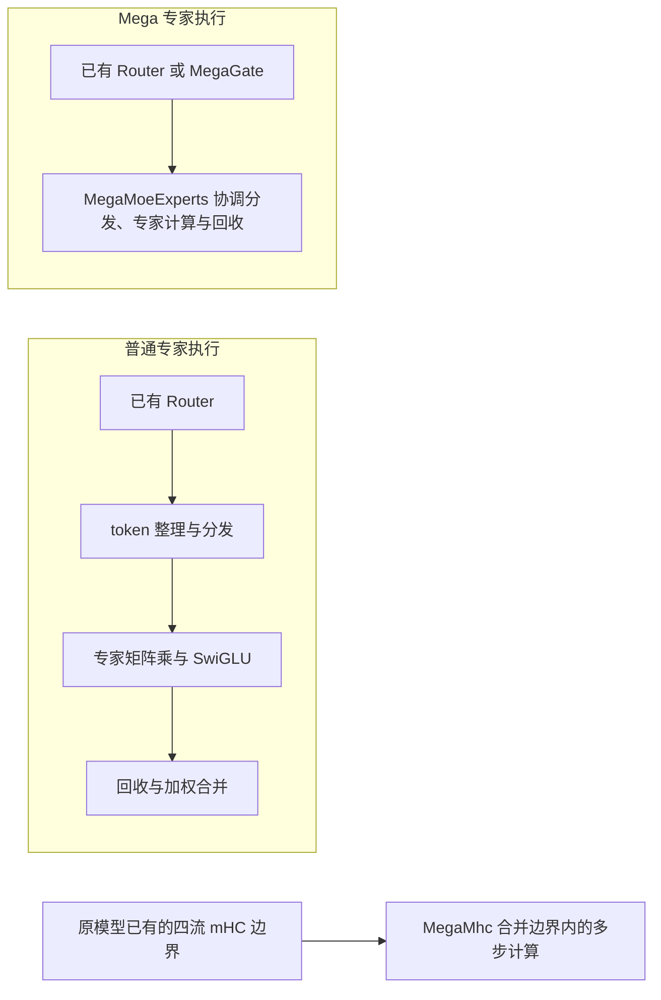

# Multicore 多核并行使用指南

Multicore 是 HyperParallel 的 Torch 组件，提供芯片内多核 MPMD 执行能力。
它通过 AIC/AIV 分工和核级单边通信，把通信、矩阵乘与向量计算按 tile 编排，减少 kernel 启动并重叠通信与计算。
当前业务接口包括 MoE 专家、Router 和四流 shifted mHC；三个组件可分别使用。

[MegaMoe 路由融合与 HBM 存储约束](docs/mega_moe_route_fusion.md)

## 功能与适用范围

| 接口 | 执行内容 | 设备与精度 |
| --- | --- | --- |
| `MegaMoeExperts` | TopK 分发、grouped SwiGLU 专家计算、回收与加权合并 | Ascend NPU；BF16 激活及专家权重，FP32 路由权重 |
| `MegaGate` | 线性投影、评分与 TopK | NPU 非空 `sqrtsoftplus` 使用原生 Route；其他支持场景使用 Torch |
| `MegaMhc` | 四流 shifted mHC 的残差混合、映射预测和输入 RMSNorm | Ascend NPU；BF16 激活/RMSNorm 权重，FP32 映射参数 |

MegaMoe 不包含共享专家或 Router 的辅助 loss；这些仍由模型执行。
MegaMhc 用于已有四流 mHC 结构，首层状态初始化、跨层传递和末层合并由模型管理。
多核调度及通算掩盖原理见[架构设计](docs/architecture.md)。



## 安装与运行准备

按[构建与交付](docs/build.md)安装当前 checkout，构建并激活包含所需 SoC 的 multicore native payload。
业务从 `hyper_parallel.core.multicore` 显式导入接口；HyperParallel 根包不导出这些组件。
原生库按需加载，SHMEM 由组件管理。

使用 MegaMoe 前，每个进程先选定本地 NPU、初始化 HCCL 进程组，并为 EP rank 配置可达的
`HYPER_PARALLEL_SHMEM_BOOTSTRAP_ENDPOINT=tcp://<root-rank-ip>:<port>`。
`ep_group` 显式传入 WORLD 或子组，EP 大小由组推导，专家归属按组内 rank 顺序解释。
MegaGate 和 MegaMhc 可单卡使用，无需为它们初始化 SHMEM。

可运行的模型与启动命令见 [MoE 示例](examples/moe/README.md#运行)和 [mHC 示例](examples/mhc/README.md#运行)。
MoE 默认单机 EP8，也支持其他 EP 大小；dense mHC 示例使用单 NPU。
已有模型的参数迁移及替换代码统一放在 [examples 接入指南](examples/README.md)。

## 公共接口

以下片段嵌入已准备好设备、模型输入和 EP 通信域的业务进程。

### MegaGate

```python
import torch
from hyper_parallel.core.multicore import MegaGate

gate = MegaGate(
    hidden_size=512, num_experts=48, top_k=8,
    scoring_func="sqrtsoftplus", routed_scaling_factor=1.0,
).to(device="npu", dtype=torch.bfloat16)
logits, topk_weights, topk_ids = gate(hidden_states)
```

输入为 `[B,S,H]`，返回普通 tuple：`logits: [T,E]`、`topk_weights: [T,K]`、`topk_ids: [T,K]`，其中 `T=B*S`。
投影遵循 Torch autocast，logits 保留投影精度，路由权重为 FP32，索引为 INT64。
支持 `sqrtsoftplus`、`softmax`、`sigmoid`，保持原模型的评分定义。
`bias` / `bias_vl` 是 FP32 TopK 修正偏置；传入 `[B,S]` 的 `image_mask` 须启用 `vision_enabled=True`，
原生视觉路径还要求连续 BOOL mask 与输入位于同一 NPU。原生 Route 仅支持一阶反向。

### MegaMoeExperts

```python
import torch
import torch.distributed as dist
from hyper_parallel.core.multicore import MegaMoeExperts

experts = MegaMoeExperts(
    hidden_size=512, intermediate_size=128, num_experts=48, top_k=8,
    ep_group=dist.group.WORLD,
).to(device="npu", dtype=torch.bfloat16)
output = experts(hidden_states, topk_ids=topk_ids, topk_weights=topk_weights)
```

`num_experts` 是全局专家数，须能被 EP 整除；`ep_size` 可省略，显式给出时须与组大小一致。
输入和输出保持相同 shape；分布式场景必须显式传入 `ep_group`，不自动选择 WORLD。

#### 输入与权重

- 激活最后一维为 `H`，展平后的本 rank token 数为 `T`。索引和权重均为 `[T,K]`，使用全局专家编号，
  同一 token 的 K 个 ID 不重复；各 rank 可不等长或为空。
- 可选 `tokens_per_expert` 是同 device 的精确本 rank `[E]` histogram。省略时内部统计；
  传入时调用方保证与当前 ID 一致。连续 INT32 可直接使用，INT64 或非连续输入会转换。
- 默认 `expert_weight_layout="EIO"` 的本地权重为 `gate_up_weight: [E/EP,H,2I]`、`down_weight: [E/EP,I,H]`；
  选择 `"EOI"` 时为 `[E/EP,2I,H]` 和 `[E/EP,H,I]`，须使用连续存储。
  gate/up 顺序、SwiGLU 定义及可选 `swiglu_limit` 必须与原模型一致。
- `create_parameters=False` 用于外部参数管理；每次 forward 通过 `expert_weights=(gate_up, down)`
  提供当前已 materialize 的连续本地权重。参数迁移及 checkpoint 说明见 [examples](examples/README.md#checkpoint与参数归属)。

### MegaMhc

```python
import torch
from hyper_parallel.core.multicore import MegaMhc

mhc = MegaMhc(hidden_size=512).to(device="npu", dtype=torch.bfloat16)
residual, pre, post, mix, block_input = mhc(
    previous_output, residual, previous_pre, previous_post, previous_mix,
)
```

输入依次为 `[...,H]`、`[...,4,H]`、`[...,4]`、`[...,4]`、`[...,4,4]`；
输出依次为更新的 residual、pre、post、mix 及当前 block 输入，使用普通五张量 tuple。
`phi`、`alpha`、`bias` 保持 FP32，整网 dtype 转换不会把它们舍入到 BF16；`norm_weight` 使用 BF16。
训练要求 H 为128的倍数且不超过5760，Sinkhorn 为20次；本地 token 数至少为 `max(40, 当前设备 AIV 核数)`。
CP/SP 切分后的输入也须满足该下限。完整状态接线见 [mHC 示例](examples/mhc/model.py)。

## 动态 token 与容量

MegaMoe 从实际 forward 输入自动维护容量，无需 token 上限或动态/静态模式开关。
构造时不分配通信 workspace，首次绑定从128行的最小 source token 容量开始，按实际需求增长并保留高水位。
调度计划按几何桶缓存，待反向图保留原计划；桶大小不改变真实 token 激活形状。
初次绑定、进入新桶及扩容有额外成本；稳定容量和已缓存计划可复用。

`dispatch_mode="push"` 为默认值，也可选择 `"pull"`；两者的 combine 都使用 PUT。
模式须在 EP rank 间一致，不能在同一 workspace 上切换。pull 在容量准备和 claim 后才写 source。

| 参数 | push 默认值 | 作用 |
| --- | --- | --- |
| `initial_capacity_factor` | `1.25` | 首次接收容量相对预留 source 路由行数的倍数 |
| `capacity_growth_factor` | `1.25` | 接收容量增长倍数；`1.0` 仅满足当次需求 |

两个因子须是有限数且不小于1；省略或 `None` 采用默认值。pull 不接受显式容量因子。
即使 token 数固定，热点也可能触发 push 接收区扩容；路由不丢 token。
source 容量、调度行数与实际 owner 接收量分别维护：source/返回区按预留容量，
计算中间张量及待反向激活按实际接收量分配，空 owner 保留一行 ABI 占位。
pull 的接收区位于普通 HBM，不属于 SHMEM source/返回区。

扩容可能集体重启同一 SHMEM root 的 runtime，再恢复受管 workspace；外部专家参数不移动。
`HYPER_PARALLEL_SHMEM_HEAP_SIZE` 可设置固定字节预算；预算不足或不能安全重启时明确失败。
容量策略、固定预算和失败恢复的完整契约见 [SHMEM runtime restart](docs/shmem.md#4-runtime-restart)。

## 资源共享与生命周期

相同配置的串行层可在首次 forward 前共享 workspace：

```python
from hyper_parallel.core.multicore import MegaMoeExperts

MegaMoeExperts.share_execution_resources(layer.mlp.experts for layer in model.layers)
```

共享只影响执行资源，各层参数、梯度和待反向激活独立。每个 root 须串行提交；
跨 stream 时调用方先建立输入依赖，不支持并发线程提交或图捕获。
支持 non-reentrant checkpoint、延迟 backward 和 `retain_graph=True`，关闭前须完成所有待反向图。
所有 SHMEM root rank 按相同顺序调用，并采用一致的梯度参与策略。

运行时托管 workspace。GC 只登记释放，后续首次绑定时由各 rank 协调回收兼容孤儿资源；
标准 `dist.destroy_process_group()` 在销毁通信域前执行受管清理。
需要提前释放时可同序调用 `experts.close()`，共享 workspace 由最后一个成员释放，普通参数不受影响。
关闭失败可在安全条件下重试；runtime 部分释放或重启失败需退出并重启进程。
异常退出及通信故障不承诺及时集体清理，详细限制见 [SHMEM 生命周期](docs/shmem.md)。

## DSV4.1 的 TP/SP 与 CP 集成

DSV4.1 适配器在 push 和 pull 模式下均支持 CP，以及配合序列并行使用的 TP。
开启 TP 时要求 `sequence_parallel: true` 且 `ep_size > 1`；PP 必须保持为 1。
框架从展平后的 dense DP/CP/TP 域生成 EP mesh。
路由专家仅沿专家维度分片，保留完整的隐藏维度和中间维度；
稠密层及共享专家沿用各自的 TP 布局，不支持对路由专家矩阵做张量并行。

MoE 边界直接消费经过 CP 和 TP/SP 划分后的 token。
VLM 路由时，适配器将 CP 局部图像 mask 对齐到 TP 局部隐藏状态区间。
共享专家的 TP 通信仍由其嵌套边界负责。

例如，16 个 rank 使用 TP2、CP2、EP16 和 micro-batch size 1 时，可配置为：

```yaml
accelerator:
  tp_size: 2
  cp_size: 2
  ep_size: 16
  pp_size: 1
  sequence_parallel: true
fsdp_config:
  dp_shard_size: 8
  edp_shard_size: 1
training:
  global_batch_size: 4
  micro_batch_size: 1
```

该配置对应 dense DP4、dense FSDP8 和 expert FSDP1。
将这些字段合并到现有 DSV4.1 配置中，保留其模块替换和 compute 声明。
长度为 4096 的序列均匀划分后，每个 rank 向 MegaMoe 提交 1024 行。
组件使用经过 CP/SP 划分后的实际行数维护容量，不需要额外配置 token 上限。
source/receive 容量保留历史高水位，不会因更小输入自动缩小。
TP 不会进一步切分路由专家矩阵；本地序列变短也可能降低 MegaMoe 的执行效率。

激活 NPU native payload 后，可执行以下分布式精度对齐测试矩阵：

```bash
pytest -q tests/torch/multicore/test_deepseek_v41_megamoe.py -k megamoe_parallel
```

该 8-rank 矩阵覆盖 TP2/CP1、TP1/CP2、TP2/CP2、push/pull、文本/VLM 路由、
动态本地行数，以及输出、输入梯度、路由梯度、专家梯度和共享专家梯度。
验证范围为 MoE 模块及实际接入边界，不代表整网训练或性能验收。

## 诊断与性能验证

使用 [MegaKernel Profiling 与 Tensor dump](docs/mega_kernel_profiling.md) 查看 AIC/AIV 内部 timeline
及中间 Tensor；两类工具的 session 互斥。

正式比较固定模型、输入、精度、EP owner 和优化器配置，排除编译/扩容预热及外部设备进程，并关闭诊断采集。
组件 ST 检查数值与生命周期；[两个模型 benchmark](examples/README.md#独立模型与验证范围)检查完整训练 step，
分别报告其验证范围。

## 进一步阅读

- [模型接入指南与示例](examples/README.md)：已有模块替换、参数布局、checkpoint 和训练顺序。
- [构建与交付](docs/build.md)：SoC 目标、native payload 与 editable 安装。
- [架构设计](docs/architecture.md)：计算图、任务切分、多核调度与通算掩盖。
- [Profiling 与 Tensor dump](docs/mega_kernel_profiling.md)：内部 timeline、中间 Tensor 与离线分析。
- [私有 SHMEM](docs/shmem.md)：通信、容量与 runtime 生命周期。
